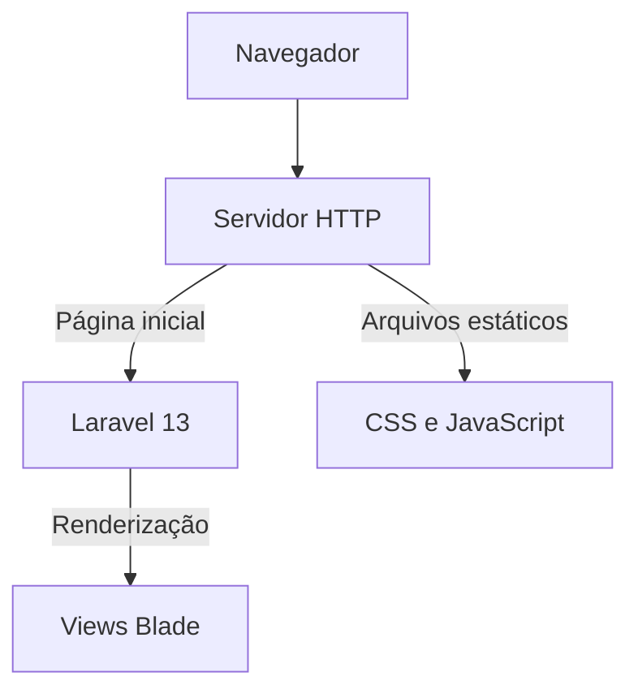
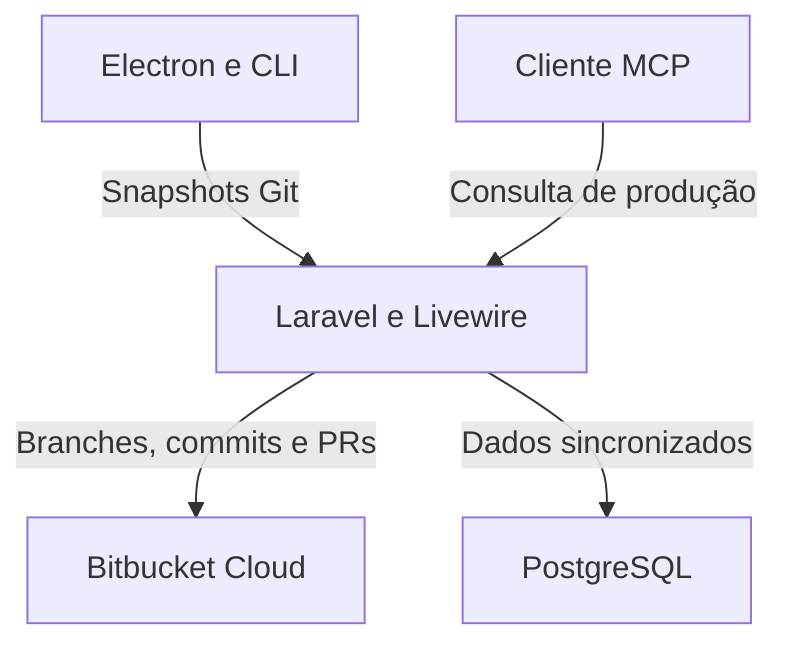

# Portfólio de Lucas Santos

Portfólio desenvolvido para [lucassc.dev](https://lucassc.dev/). O site reúne minha experiência com PHP, Laravel e qualidade de software e apresenta três projetos por meio de demonstrações interativas.

## O que experimentar no site

| Projeto | Demonstração |
| --- | --- |
| Assistant | Filtrar pull requests por repositório e status e gerar um resumo simulado. |
| Bravo | Explorar um catálogo de carros, adicionar veículos ao carrinho e simular uma reserva. |
| Plataforma de Ensino | Buscar alunos e cursos e registrar uma matrícula com validação de duplicidade. |

As demonstrações usam dados fictícios e mantêm o estado no navegador durante a visita. Recarregar a página restaura os dados iniciais.

## Arquitetura do portfólio

O Laravel 13 renderiza a página inicial com Blade. O CSS define a identidade neobrutalista e o layout responsivo. O JavaScript das demos cuida dos filtros, das seleções e das alterações de estado a partir dos dados fictícios. O servidor entrega esses arquivos diretamente da pasta `public/`.



| Arquivo | Responsabilidade |
| --- | --- |
| [`routes/web.php`](routes/web.php) | Mapeia `/` para a página do portfólio. |
| [`bootstrap/app.php`](bootstrap/app.php) | Registra as rotas e a checagem de saúde em `/up`. |
| [`resources/views/portfolio.blade.php`](resources/views/portfolio.blade.php) | Organiza perfil, experiência, projetos e contatos. |
| [`resources/views/demos/`](resources/views/demos/) | Contém a apresentação e os controles de cada demo. |
| [`public/assets/portfolio.js`](public/assets/portfolio.js) | Define os dados fictícios e o comportamento das demos. |
| [`public/assets/portfolio.css`](public/assets/portfolio.css) | Define o layout, as cores e as ilustrações. |

## Arquitetura dos projetos apresentados

### Assistant

Ferramenta para acompanhar branches, commits e pull requests do Bitbucket junto com as alterações dos repositórios Git locais.

- **Aplicação web** desenvolvida em Laravel 13 e Livewire. Consulta o Bitbucket Cloud, exibe as alterações e armazena no PostgreSQL os snapshots sincronizados por máquina.
- **Cliente desktop e CLI** em Electron e Node.js, com um núcleo compartilhado que lê branches, commits e diffs locais. A sincronização usa uma API JSON autenticada com Laravel Sanctum.
- **Servidor MCP** disponibiliza dados sobre pull requests integrados à produção para que clientes de IA possam montar relatórios.



[Abrir o site do Assistant](https://assistant.lucassc.dev/)

### Bravo

Loja de carros com interface web e mobile. O **front-end em Angular e Ionic** consome a API do catálogo e apresenta o fluxo de carrinho e pedido. O Capacitor permite empacotar o app para Android e iOS.

O **back-end em Laravel 11** oferece rotas de autenticação JWT, busca de produtos, endereços, carrinho e pedidos. O MySQL armazena os registros da aplicação.

[Front-end no GitHub](https://github.com/GiltMonster/Bravo-front) · [Back-end no GitHub](https://github.com/GiltMonster/Bravo-backend)

### Plataforma de Ensino

Sistema administrativo para gerenciar alunos, cursos e matrículas, feito em **PHP 8.2 com arquitetura MVC**. O Apache atende a pasta `public/` e encaminha requisições da aplicação a `public/index.php`. Os controllers recebem as ações, os models acessam o MySQL 8 e as views renderizam as páginas em PHP.

O Docker Compose organiza o ambiente de desenvolvimento. O Phinx versiona a estrutura do banco e o PHPUnit verifica fluxos como autenticação e operações de alunos.

[Plataforma de Ensino no GitHub](https://github.com/GiltMonster/plataforma-ensino)

## Rodar localmente

Use PHP 8.4.1 ou superior e Composer. No primeiro setup, execute os comandos abaixo na raiz do projeto.

```sh
composer install
cp .env.example .env
php artisan key:generate
php artisan serve
```

Abra o [portfólio local](http://127.0.0.1:8000) e use a [rota de saúde](http://127.0.0.1:8000/up) para verificar se o Laravel está respondendo.
